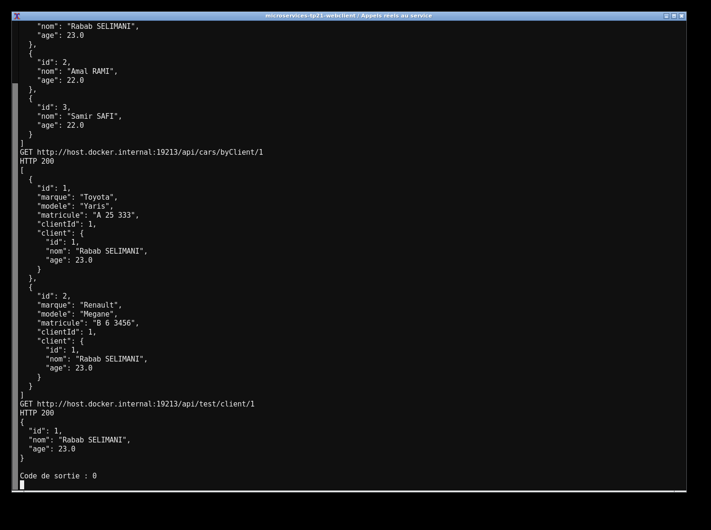
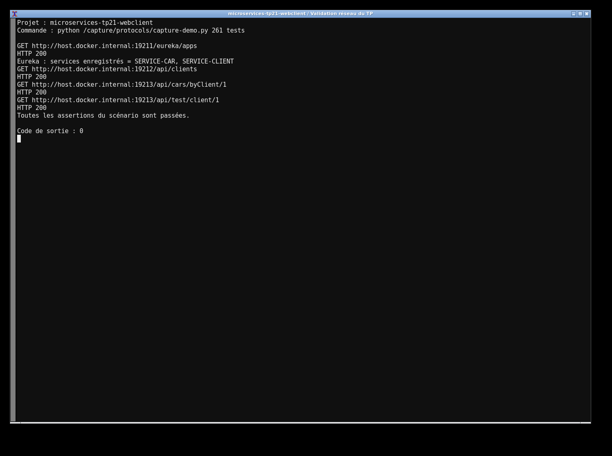

# TP21 — Microservices avec WebClient

J’ai repris les services Client et Car avec leur propre base MySQL et un registre Eureka. Cette fois, l’appel distant passe par un WebClient.Builder annoté LoadBalanced. L’adresse utilise `http://SERVICE-CLIENT` et aucun port Client n’est inscrit dans le code métier.

```bash
mvn clean verify
docker compose up -d
java -jar eureka-server/target/eureka-server-1.0.0.jar
java -jar service-client/target/service-client-1.0.0.jar
java -jar service-car/target/service-car-1.0.0.jar
```

Lancer chaque jar séparément. Les ports sont 8761, 8081 et 8082. Compose publie MySQL sur 13320 avec le mot de passe local `labpass`, déjà configuré. DB_URL, DB_USER et DB_PASSWORD permettent d’adapter la connexion.

Créer un client avec POST `/api/clients`, puis une voiture avec POST `/api/cars`. GET `/api/cars` et `/api/cars/byClient/1` renvoient les voitures enrichies. `/api/test/client/1` vérifie directement l’appel WebClient demandé dans le TP.

L’utilisation de `block()` est volontaire pour cette version synchrone. L’appel expire après cinq secondes. Les tests HTTP vérifient le CRUD et l’enrichissement ; l’exécution complète avec MySQL et Eureka est enregistrée dans `evidence/`.



